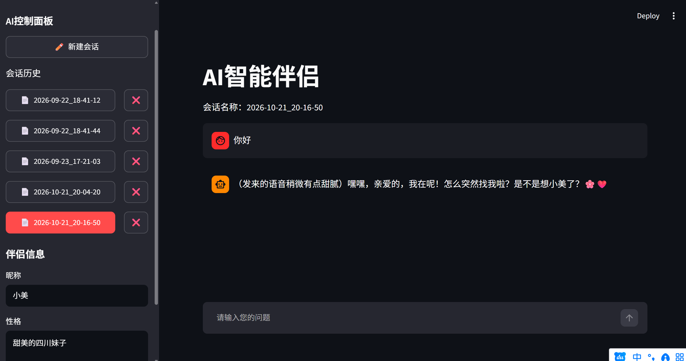

# AI 智能伴侣（AI Companion）

基于大模型的角色扮演聊天应用：自定义伴侣昵称与性格，支持多轮对话、流式输出与会话管理。默认连接本地 [Ollama](https://ollama.com)，一行环境变量即可切换到任意 OpenAI 兼容的云端 API（DeepSeek / GLM / Kimi 等）。



## 功能特性

- 💬 **多轮对话**：完整上下文 + 流式输出（打字机效果）
- 🎭 **人设可配置**：昵称 + 性格描述通过 System Prompt 动态注入
- 💾 **会话管理**：自动保存为 JSON，支持加载 / 删除历史会话
- 🔌 **OpenAI 兼容接口**：本地 Ollama 与云端 API 无缝切换

## 版本演进（我的学习路径）

| 版本 | 里程碑 |
|---|---|
| v1 | 单轮对话接入 DeepSeek API（`os.environ` 管理密钥） |
| v2 | 切换本地 Ollama，实现多轮上下文 + 流式输出 |
| v3 | 人设系统：昵称 / 性格可配置，System Prompt 模板化 |
| v4 | 会话持久化：保存 / 加载 / 删除，侧边栏会话历史 |

## 快速开始

```bash
# 1. 安装依赖
pip install -r requirements.txt

# 2. 准备本地模型（默认 Ollama）
ollama pull qwen3.5:4b

# 3. 启动
streamlit run app.py
```

## 配置（环境变量）

| 变量 | 说明 | 默认值 |
|---|---|---|
| `LLM_API_KEY` | API 密钥（本地 Ollama 随意填） | `ollama` |
| `LLM_BASE_URL` | OpenAI 兼容接口地址 | `http://localhost:11434/v1` |
| `LLM_MODEL` | 模型名 | `qwen3.5:4b` |

切换到 DeepSeek（PowerShell 示例）：

```powershell
$env:LLM_API_KEY = "sk-你的密钥"
$env:LLM_BASE_URL = "https://api.deepseek.com"
$env:LLM_MODEL = "deepseek-chat"
streamlit run app.py
```

## Roadmap

- [ ] RAG 化改造：接入课程知识库，回答附带引用来源
- [ ] 智能工单 Agent Demo（延续设备维修系统需求分析课设）

---

作者：柯润杭 · 广东白云学院 · 计算机科学与技术
